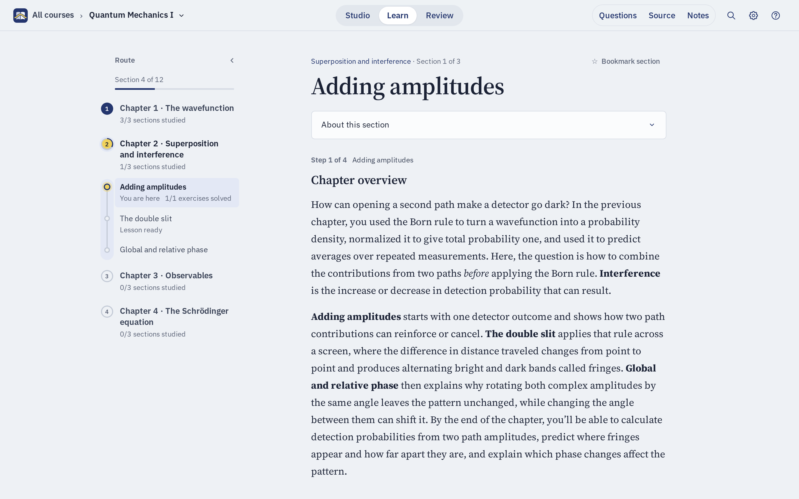
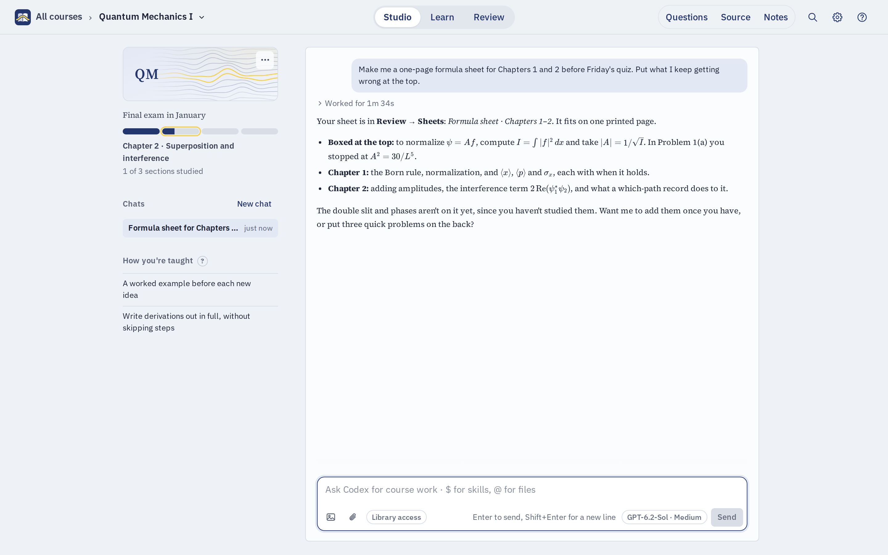
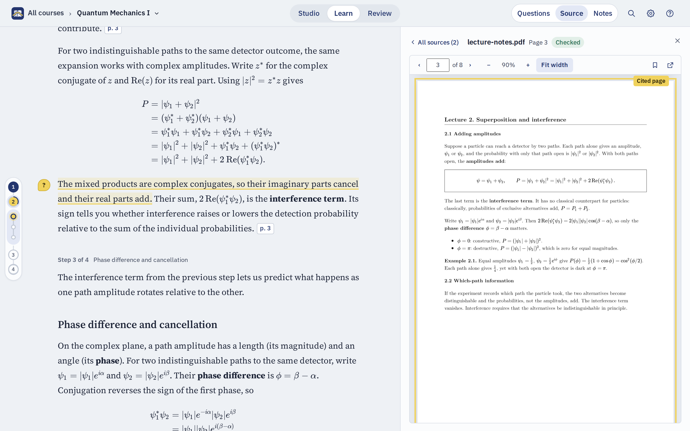
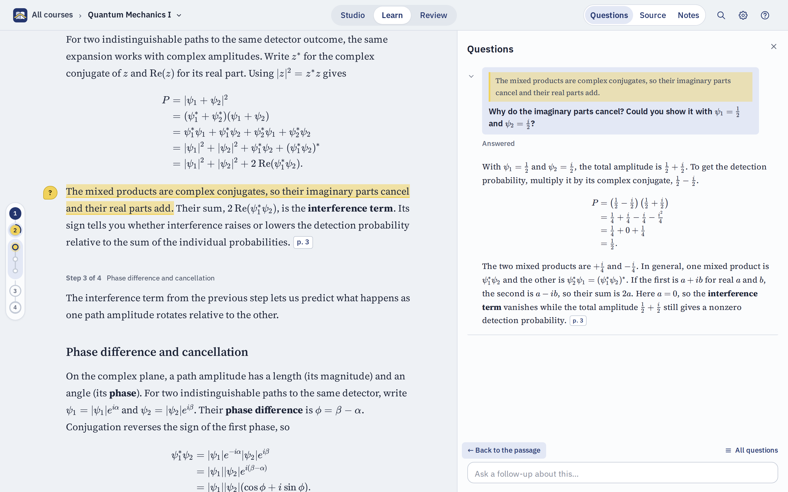
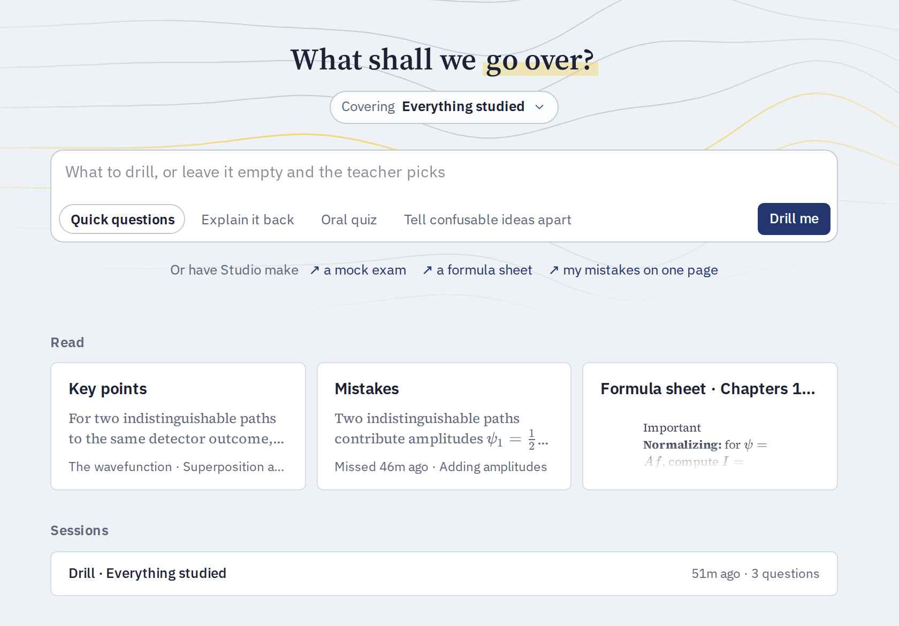

<p align="center">
  
  
</p>

<p align="center"><b>One line of teaching through all your documents.</b><br>A local study app that turns your PDFs and notes into a guided course, taught by Codex.</p>

<p align="center"><b>English</b> · <a href="README.zh-CN.md">简体中文</a></p>



Throughline organizes several PDFs, slide decks, Word documents and text notes into one source-linked route, then teaches it in your browser: lessons in steps that cite their pages, key points, questions about any passage, the original page beside the explanation, practice checked part by part, review whenever you want it, and a saved place to resume. Codex itself works on the course beside it, in Studio.

The teacher makes instructional judgments from your materials. The program validates state and references; it never decides on its own that you have understood something. Everything runs on your computer, with your own Codex as the teacher.

## Install

Open a terminal (Terminal on macOS, PowerShell on Windows) and run the install script. It installs [uv](https://docs.astral.sh/uv/) if you don't have it, which brings its own Python:

```sh
# macOS and Linux
curl -LsSf https://raw.githubusercontent.com/keweijun/throughline/stable/install.sh | sh
```

```powershell
# Windows (PowerShell)
irm https://raw.githubusercontent.com/keweijun/throughline/stable/install.ps1 | iex
```

The script installs the app (no Node.js needed), adds the `$throughline` skill, creates your Throughline folder and a **Throughline** launcher in your app menu, and opens Throughline in your browser with a short welcome guide in the terminal. Afterwards, `throughline` in a terminal opens it too.

Throughline teaches with Codex (the desktop app or the [CLI](https://learn.chatgpt.com/docs/codex/cli)), signed in or set up with an API key. You can set Codex up before or after installing Throughline: while it is missing or not signed in, the library says what to do.

To **update**, use **Settings → About → Update**: Codex installs the newer version in the background and Throughline comes back by itself. Running the install script again updates it too. Your courses are kept either way.

### For Codex: updating Throughline

When a user, or Throughline's one-click update, asks you to update Throughline, run these steps yourself, outside the sandbox (they need the network and write outside the workspace). The user should not have to type anything.

1. If `throughline --version` already works, run `throughline stop` first. On Windows a running Throughline locks its own files and the upgrade would fail.

   Then remove the package's pre-0.5.1 name, which installs the same command, with the tool that installed it: `uv tool uninstall codex-guided-learning`, `pipx uninstall codex-guided-learning`, or `python -m pip uninstall -y codex-guided-learning`. An error that it is not installed is fine. Courses are kept.
2. Install the latest release from GitHub, using the first tool that is available:
   - `uv tool install --reinstall-package throughline "throughline[pdf] @ git+https://github.com/keweijun/throughline@stable"`
   - `pipx install --force "throughline[pdf] @ git+https://github.com/keweijun/throughline@stable"`
   - `python -m pip install --user --upgrade "throughline[pdf] @ git+https://github.com/keweijun/throughline@stable"`

   If none of them is available (or Python 3.10 or newer is missing), install uv with its [official installer](https://docs.astral.sh/uv/getting-started/installation/) and use the first line.

   If `throughline` is then not on PATH, run `uv tool update-shell` (or `pipx ensurepath`) and use the full path the installer printed for the next step.
3. Run `throughline setup`, adding `--language zh-CN` if the user writes to you in Chinese. It is safe to repeat: it updates the skill and launcher, never touches existing courses, and opens Throughline in the browser when it is done.
4. Tell the user which version is now installed (`throughline --version`).

`install.sh` and `install.ps1` run these same steps with uv; keep them in step with this list.

### Install or update by hand

With [uv](https://docs.astral.sh/uv/) (recommended):

```sh
throughline stop                 # when updating; skip on a first install
uv tool install --reinstall-package throughline "throughline[pdf] @ git+https://github.com/keweijun/throughline@stable"
throughline setup                # add --language zh-CN for the Chinese welcome guide
```

With pipx, replace the second line with `pipx install --force "throughline[pdf] @ git+https://github.com/keweijun/throughline@stable"`. Both forms fetch the latest release, so the same three lines install and update. `stable` always points at the latest release; each release is also tagged, with its changes in [CHANGELOG.md](CHANGELOG.md), so `@v0.45.0` in place of `@stable` installs that version. Going back to an older version can leave courses that a newer one has already updated unreadable to it. Run `throughline --version` to see what you have, and `throughline doctor` to check that Codex is found and answers (it sends one tiny message to a small model).

Updating from a version before 0.5.1, when the package was named `codex-guided-learning`: run `uv tool uninstall codex-guided-learning` (or `pipx uninstall codex-guided-learning`) after `throughline stop`, then continue as above.

To uninstall, run `throughline stop`, then `uv tool uninstall throughline` (or `pipx uninstall throughline`), and delete `~/.agents/skills/throughline` and the launcher. Your courses stay in your Throughline folder until you delete it.

## Create your first course

After installing, Throughline opens in your browser on your course library. **New course** asks what you would like to learn, and **Studio**, Codex working inside Throughline, takes it from there:

1. Drop your PDFs or notes onto the page (or name the folder they are in), and say in a sentence what you want to learn, for example "quantum mechanics up to perturbation theory, for my exam".
2. Codex asks a few quick questions: your goal and deadline, how well you know each prerequisite it found in the files, and how much detail you want. Then it suggests a course name, copies your files into the Throughline folder, builds a route across them and tells you what still needs checking.
3. When it is done, the course opens, with the same chat in its Studio. Next time, open Throughline from the **Throughline** launcher in your app menu.


Later courses work the same way: **New course** in the library, or `$throughline` in any Codex chat. If your Codex is too old for Studio, the library's buttons open a Codex chat with the request typed in instead.

## How it works

Each course has three places, side by side in the top bar: **Studio · Learn · Review**.

- **Studio** is Codex working on your course. Ask it to add a problem set, rebuild a chapter, check pages, teach a chapter more rigorously, or make you a mock exam or a formula sheet; attach or drop files, mention them with `@`, and approve what Codex asks. You can keep studying while it works: the top bar says when Studio needs you. Beside the chat stand the course's cover and goal, a strip of its chapters filled as you study, your Studio chats, and **How you're taught**: the preferences the teacher follows. Tell Studio how you like to be taught, and it is remembered for the course.
- **Learn** is where lessons, questions and practice happen. They run Codex in the background, so you never need Codex open to study.
- **Review** is where you go over what you have studied, whenever you like (below).

The library is **All courses**: the course you studied last leads with **Continue**, and every other course is a card with a cover Codex chose for it. A card's ⋯ menu has **Add files**, which opens that course's Studio with the request filled in, and Share, Rename, Archive and Delete. Open Throughline from the **Throughline** launcher in your app menu (setup adds it), or run `throughline`; the library says where the launcher is, can add it to your desktop, and says so if Codex can't answer.



## Learn

- **The route.** The left rail is the course: chapters, their sections, and how far you are ("Section 4 of 12"). A section opens with **About this section**: the question it answers, what you will be able to do, its steps and its sources.
- **Lessons in steps.** The first lesson of a chapter opens with an overview of the chapter; later sections pick up from the one before. The teacher teaches a step at a time, often ending with a quick check, and **Continue** moves on. Text streams in and is saved when complete; you can pause, or have the section taught again as a new lesson with **Teach again…**.
- **Key points.** Every section ends with its key points: the results, rules and methods to hold, each with when it holds and a common mistake, linked back to the step and page that taught it. A chapter's page gathers them.
- **Questions on the side.** Select a sentence or formula, in a lesson or an exercise, and ask about it; the answer comes in the side panel and the lesson stays where it is. Questions that a later section answers properly are saved for that section.
- **Sources.** Hover a citation to see the cited text; click it to open the exact page or line in the built-in reader. Unchecked sources stay marked "Not checked yet".
- **Practice.** Exercises follow each lesson and are checked part by part. **Hint**, **Key steps**, **Full solution** and **Ask about this** are always there, but help is recorded, so a helped answer never counts as solved on your own. **Another like this**, **Do later** and **Skip** are in an exercise's ⋯; if the exercises don't suit you, ask for different ones and say what should change.
- **Help.** `?` shows what you can do in the app, the course and the section you're reading, with **Show me** to point at each control, and the keyboard shortcuts. The first time you meet something you can't see, like selecting a passage, a short tip says how it works.

<table>
  <tr>
    <td></td>
    <td></td>
  </tr>
  <tr>
    <td align="center">The cited page, beside the lesson</td>
    <td align="center">A question about a passage</td>
  </tr>
</table>

## Review

Nothing comes due: **Review** is there whenever you want to go over what you have studied.

- **Drill.** Say what to drill, or leave it empty and the teacher picks, mostly from what you missed and what you haven't practised for a while. Choose how it asks: **Quick questions**, **Explain it back**, **Oral quiz** or **Tell confusable ideas apart**. **Covering** narrows it to some chapters or sections. Ask about an answer or for more questions right there; sessions are kept to come back to.
- **Read.** Your **Key points** for what you are reviewing, your **Mistakes** (what you answered and the feedback, kept with the date once you get it right), and the **sheets** Studio wrote for you, ready to print.
- **Have Studio make it.** A mock exam, a formula sheet, or your mistakes on one page: Studio makes it from your key points and mistakes, a mock exam becomes a session you answer in Review, with marks, and a sheet appears under Read.

Before a section that builds on something you studied a while ago, you are offered a short warm-up, and each chapter's page offers a drill of that chapter.



The interface and new teaching default to English; switch to Simplified Chinese under Settings (the gear in the top bar) → Appearance → Language, where you can also choose light or dark and the text size for reading. Imported materials and earlier records keep their original language. **Settings → Activity** shows when you studied, as a calendar across all your courses. More in [using the interface](docs/learning-ui.md).

## Where things live

- **Courses:** your Throughline folder, `~/Throughline` (`C:\Users\<you>\Throughline` on Windows). It is deliberately outside Documents, which OneDrive and iCloud often sync: a course's database can be corrupted by sync. To use another folder, set `THROUGHLINE_HOME`; if you point it at a synced folder, open each course on only one computer at a time. It holds an `AGENTS.md` that tells Codex how to work there. Each course is one subfolder holding its source files (`inputs/`), snapshots, route, position and learning evidence, and in `backups/` a copy of the course from before each update of its format; to move a course, stop the app and copy its folder.
- **Teacher settings:** open **Settings** (the gear in the top bar) to pick the teacher model, a small model for background preparation and note consolidation, reasoning effort for each, and fast mode; the model lists come from your Codex sign-in. Studio's own model and its access (Library or Full) are chosen in its writing box, as in Codex. They are saved per user in `~/.config/throughline/settings.json` (`%APPDATA%\throughline\settings.json` on Windows), never in a course.

Extracted text does not verify formulas, images or coverage, so the library and reader show what still needs review. See [creating and reviewing a course](docs/course-import.md).

## Commands behind the prompts

```sh
throughline setup                 # install or update the Codex skill
throughline open [course] [--no-browser] [--port 8765]
throughline stop
throughline courses               # the library as JSON
throughline export quantum [--level route|lessons|everything]   # quantum.throughline, with its sources
throughline import quantum.throughline [--name copy] [--fresh | --keep-notes]
echo '{"op":"course.status"}' | throughline --course quantum
```

The last form is the operation entry point the skill uses; it reads one JSON request from standard input or `--request file.json` and returns `{ok, result}` or `{ok:false, error}`. `--workspace <folder>` addresses a course outside the library, and `throughline-web --workspace <folder>` serves one in the foreground. The skill and its operation references are in [throughline/skill/](throughline/skill/SKILL.md).

## Development

```sh
python -m venv .venv
.venv/bin/python -m pip install -e ".[pdf,dev]"    # Windows: .venv\Scripts\python.exe
.venv/bin/python -m unittest discover -s tests
.venv/bin/throughline setup                     # copy this checkout's skill to Codex; rerun after editing it

cd web && npm install
GL_HOST=http://127.0.0.1:8765 npm run dev          # hot-reloading UI against a running host
npm run check && npm run build                     # type check, then write throughline/web_dist (commit it)
npx playwright test                                # browser tests against disposable fixture courses
```

Read [architecture](docs/architecture.md), the [glossary](GLOSSARY.md) and the [decisions](docs/adr/) before larger changes; agent instructions are in [AGENTS.md](AGENTS.md). Tasks live in GitHub Issues. CI runs all of the above on every pull request; a version bump merged to `main` is tagged, released with its [CHANGELOG.md](CHANGELOG.md) entry and becomes what learners install ([ADR 0021](docs/adr/0021-releases-are-tagged-from-main.md)).

Throughline is licensed under [MIT](LICENSE); bundled dependencies keep the licenses listed in [third-party notices](THIRD_PARTY_LICENSES.md). The Python package is named `throughline` (`codex-guided-learning` before 0.5.1) and the command `throughline`.
