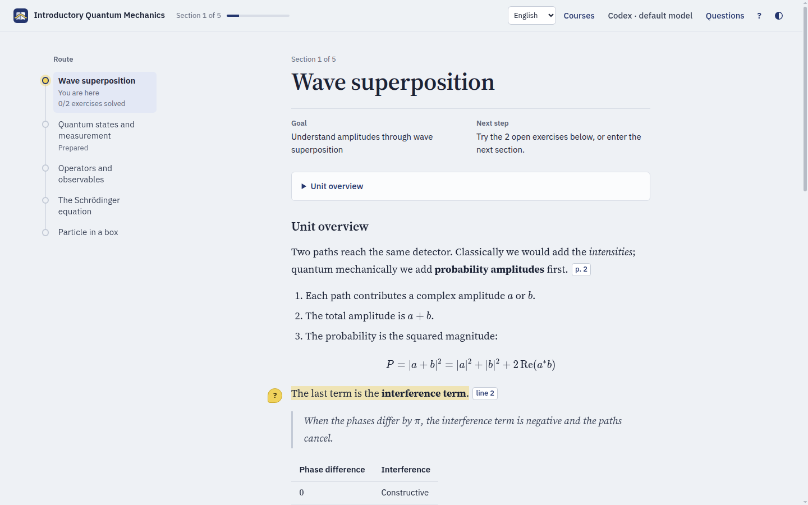
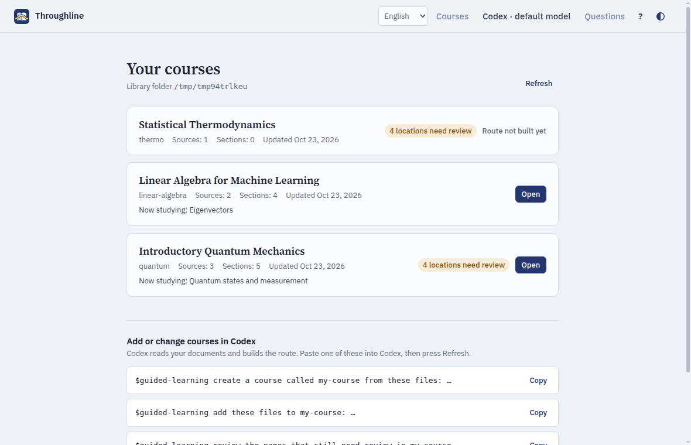
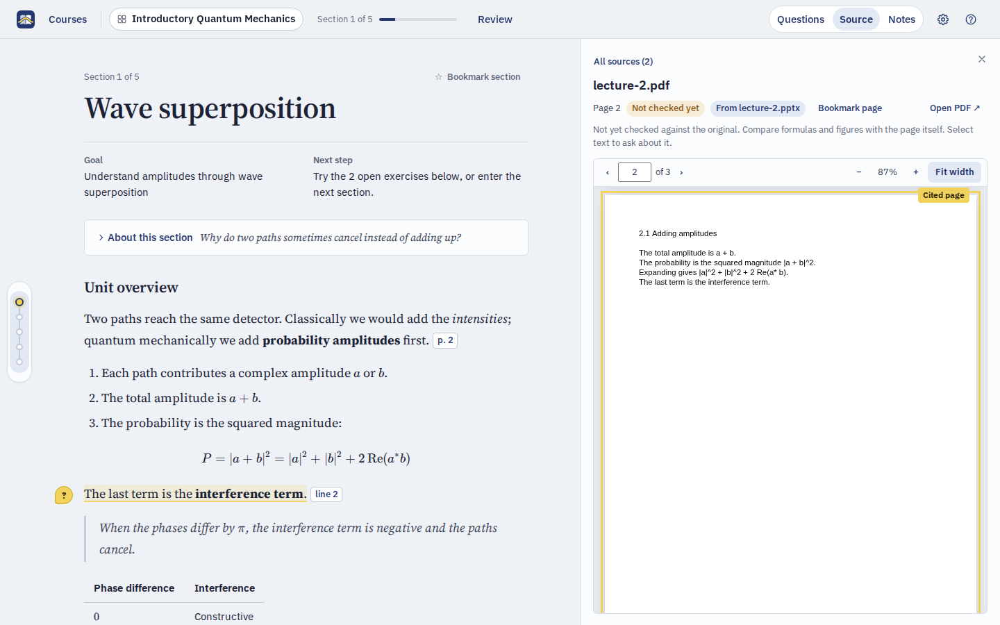
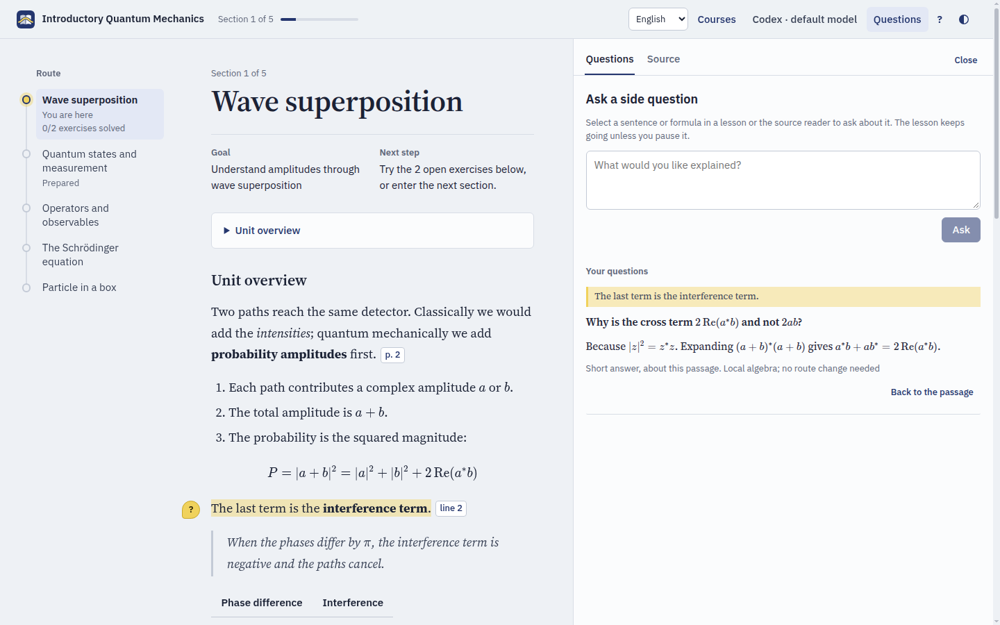

<p align="center">
  
  
</p>

<p align="center"><b>One line of teaching through all your documents.</b><br>A local study app that turns your PDFs and notes into a guided course, taught by Codex.</p>

<p align="center"><b>English</b> · <a href="README.zh-CN.md">简体中文</a></p>



Throughline organizes several PDFs and Markdown documents into one source-linked route, then teaches it in your browser: unit overviews, streaming lessons, questions about any passage, the original page beside the explanation, practice, and a saved place to resume.

The teacher makes instructional judgments from your materials. The program validates state and references; it never decides on its own that you have understood something. Everything runs on your computer, with your own Codex as the teacher.

## Install

You need Codex, signed in (the desktop app or the [CLI](https://learn.chatgpt.com/docs/codex/cli); the app includes the command Throughline uses), and Python 3.10 or newer. Paste this into Codex:

```text
Install Throughline for me: run `uv tool install --upgrade "codex-guided-learning[pdf] @ git+https://github.com/keweijun/throughline"` (if uv is missing, use `pipx install --force` with the same quoted package, or `python -m pip install --user --upgrade` as a last resort), then run `guided-learning setup` and show me its output.
```

Codex installs the app (no Node.js needed), adds the `$guided-learning` skill to `~/.agents/skills/`, and creates your course library. Paste the same prompt again to update.

## Use it from Codex

You never need to type a command. Ask Codex:

- `$guided-learning create a course called quantum from these files: …` copies the files into your course library, registers them and builds the route.
- `$guided-learning open quantum` starts the app in the background and opens it in your browser. Codex asks for permission, because the app keeps running and calls Codex for lessons.
- `$guided-learning add these files to quantum: …`, `review the pages that still need review in quantum`, or `stop the learning interface`.

The app opens on **Your courses**: every course with its sources, sections, review backlog and where you left off. Creating and changing courses stays in Codex, which does the reading and judging; the library shows prompts to paste.



## Study

- **Route and goal.** The left rail is the course route; each section shows its goal and the next thing to do.
- **Lessons.** The first lesson of a section opens with a unit overview, then teaches. Text streams in and is saved when complete; you can pause or ask for another pass.
- **Side questions.** Select a sentence or formula and ask about it. The lesson keeps going unless you pause it. Questions that a later section answers properly are saved for that section.
- **Sources.** Hover a citation to see the cited text; click it to open the exact page or line in the built-in reader. Unchecked sources stay marked "Pending verification".
- **Practice.** Exercises follow each lesson. Hints and solutions are always available, but help is recorded, so a helped answer is never counted as solved on your own.

<table>
  <tr>
    <td></td>
    <td></td>
  </tr>
  <tr>
    <td align="center">The cited page, beside the lesson</td>
    <td align="center">A side question about a passage</td>
  </tr>
</table>

The interface and new teaching default to English; switch to Simplified Chinese from the language selector. Imported materials and earlier records keep their original language. More in [using the interface](docs/learning-ui.md).

## Where things live

- **Courses:** `~/.local/share/guided-learning/courses` (`%LOCALAPPDATA%\guided-learning\courses` on Windows; set `GUIDED_LEARNING_HOME` to move it). Each course is one folder holding its source snapshots, route, position and learning evidence; to move a course, stop the app and copy its folder.
- **Teacher settings:** open **Teacher settings** (the model name in the top bar) to pick the Codex model and reasoning effort. They are saved per user in `~/.config/guided-learning/settings.json` (`%APPDATA%\guided-learning\settings.json` on Windows), never in a course.

Extracted text does not verify formulas, images or coverage, so the library and reader show what still needs review. See [creating and reviewing a course](docs/course-import.md).

## Commands behind the prompts

```sh
guided-learning setup                 # install or update the Codex skill
guided-learning open [course] [--no-browser] [--port 8765]
guided-learning stop
guided-learning courses               # the library as JSON
echo '{"op":"course.status"}' | guided-learning --course quantum
```

The last form is the operation entry point the skill uses; it reads one JSON request from standard input or `--request file.json` and returns `{ok, result}` or `{ok:false, error}`. `--workspace <folder>` addresses a course outside the library, and `guided-learning-web --workspace <folder>` serves one in the foreground. The skill and its operation references are in [guided_learning/skill/](guided_learning/skill/SKILL.md).

## Development

```sh
python -m venv .venv
.venv/bin/python -m pip install -e ".[pdf]"        # Windows: .venv\Scripts\python.exe
.venv/bin/python -m unittest discover -s tests
.venv/bin/guided-learning setup                     # copy this checkout's skill to Codex; rerun after editing it

cd web && npm install
GL_HOST=http://127.0.0.1:8765 npm run dev          # hot-reloading UI against a running host
npm run check && npm run build                     # type check, then write guided_learning/web_dist (commit it)
npx playwright test                                # browser tests against disposable fixture courses
```

Read [architecture](docs/architecture.md), the [glossary](GLOSSARY.md) and the [decisions](docs/adr/) before larger changes; agent instructions are in [AGENTS.md](AGENTS.md). Tasks live in GitHub Issues.

Throughline is licensed under [MIT](LICENSE); bundled dependencies keep the licenses listed in [third-party notices](THIRD_PARTY_LICENSES.md). The Python package and command are named `guided-learning` (package `codex-guided-learning`).
