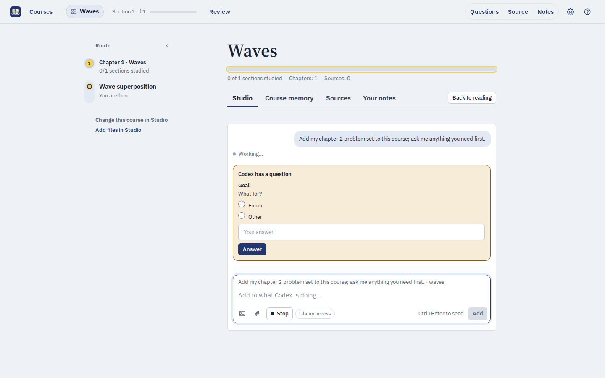

<p align="center">
  
  
</p>

<p align="center"><b>One line of teaching through all your documents.</b><br>A local study app that turns your PDFs and notes into a guided course, taught by Codex.</p>

<p align="center"><b>English</b> · <a href="README.zh-CN.md">简体中文</a></p>


Throughline organizes several PDFs, slide decks, Word documents and text notes into one source-linked route, then teaches it in your browser: chapter overviews, streaming lessons, questions about any passage, the original page beside the explanation, practice, and a saved place to resume.

The teacher makes instructional judgments from your materials. The program validates state and references; it never decides on its own that you have understood something. Everything runs on your computer, with your own Codex as the teacher.

## Install

You need Codex, signed in or set up with an API key (the desktop app or the [CLI](https://learn.chatgpt.com/docs/codex/cli)). Then paste this into Codex:

```text
Install https://github.com/keweijun/throughline
```

Or run the install script in a terminal. It installs [uv](https://docs.astral.sh/uv/) if you don't have it, which brings its own Python:

```sh
# macOS and Linux
curl -LsSf https://raw.githubusercontent.com/keweijun/throughline/main/install.sh | sh
```

```powershell
# Windows (PowerShell)
irm https://raw.githubusercontent.com/keweijun/throughline/main/install.ps1 | iex
```

Either way the app is installed (no Node.js needed), the `$throughline` skill is added, your Throughline folder and a **Throughline** launcher in your app menu are created, and Throughline opens in your browser with a short welcome guide in the chat or terminal. Afterwards, `throughline` in a terminal opens it too. To **update**, paste `Update https://github.com/keweijun/throughline` into Codex or run the script again; your courses are kept. **Settings → About → Update** installs a newer version in one click: Codex runs the update in the background and Throughline comes back by itself.

### For Codex: installing or updating Throughline

When a user asks you to install or update Throughline, run these steps yourself, outside the sandbox (they need the network and write outside the workspace). The user should not have to type anything.

1. If `guided-learning --version` already works, run `guided-learning stop` first. On Windows a running Throughline locks its own files and the upgrade would fail.

   Then remove the package's pre-0.5.1 name, which installs the same command, with the tool that installed it: `uv tool uninstall codex-guided-learning`, `pipx uninstall codex-guided-learning`, or `python -m pip uninstall -y codex-guided-learning`. An error that it is not installed is fine. Courses are kept.
2. Install the latest version from GitHub, using the first tool that is available:
   - `uv tool install --reinstall-package throughline "throughline[pdf] @ git+https://github.com/keweijun/throughline"`
   - `pipx install --force "throughline[pdf] @ git+https://github.com/keweijun/throughline"`
   - `python -m pip install --user --upgrade "throughline[pdf] @ git+https://github.com/keweijun/throughline"`

   If none of them is available (or Python 3.10 or newer is missing), install uv with its [official installer](https://docs.astral.sh/uv/getting-started/installation/) and use the first line.

   If `guided-learning` is then not on PATH, run `uv tool update-shell` (or `pipx ensurepath`) and use the full path the installer printed for the next step.
3. Run `guided-learning setup`, adding `--language zh-CN` if the user writes to you in Chinese. It is safe to repeat: it updates the skill and launcher, never touches existing courses, and opens Throughline in the browser when it is done.
4. Show the user the welcome guide that setup prints, as written. After an update, just say which version is installed (`guided-learning --version`).

`install.sh` and `install.ps1` run these same steps with uv; keep them in step with this list.

### Install or update by hand

With [uv](https://docs.astral.sh/uv/) (recommended):

```sh
guided-learning stop                 # when updating; skip on a first install
uv tool install --reinstall-package throughline "throughline[pdf] @ git+https://github.com/keweijun/throughline"
guided-learning setup                # add --language zh-CN for the Chinese welcome guide
```

With pipx, replace the second line with `pipx install --force "throughline[pdf] @ git+https://github.com/keweijun/throughline"`. Both forms always fetch the latest version, so the same three lines install and update. Run `guided-learning --version` to see what you have, and `guided-learning doctor` to check that Codex is found and answers (it sends one tiny message to a small model).

Updating from a version before 0.5.1, when the package was named `codex-guided-learning`: run `uv tool uninstall codex-guided-learning` (or `pipx uninstall codex-guided-learning`) after `guided-learning stop`, then continue as above.

To uninstall, run `guided-learning stop`, then `uv tool uninstall throughline` (or `pipx uninstall throughline`), and delete `~/.agents/skills/throughline` and the launcher. Your courses stay in your Throughline folder until you delete it.

## Create your first course

After installing, Throughline opens in your browser on your course library, where **Studio**, a Codex chat inside Throughline, asks what you would like to learn:

1. Drop your PDFs or notes into Studio (or name the folder they are in), and say in a sentence what you want to learn, for example "quantum mechanics up to perturbation theory, for my exam".
2. Codex asks a few quick questions: your goal and deadline, how well you know each prerequisite it found in the files, and how much detail you want. Then it suggests a course name, copies your files into the Throughline folder, builds a route across them and tells you what still needs checking.
3. When it is done, the course opens, with the same chat in its Studio. Next time, open Throughline from the **Throughline** launcher in your app menu.

Later courses work the same way: **New course** in the library, or `$throughline` in any Codex chat. If your Codex is too old for Studio, the library's buttons open a Codex chat with the request typed in instead.

## How it works

Throughline is where you study, and where you make and change your courses with Codex.

- **Study in Throughline.** Open it from the **Throughline** launcher in your app menu (setup adds it), or run `throughline`. Lessons, questions and practice run Codex in the background, so you never need Codex open to study. The library tells you where the launcher is, can add it to your desktop, and says so if Codex can't answer.
- **Change a course in Studio.** **Overview**, next to Learn and Review in the top bar, shows the course as a whole; its first tab, **Studio** (or press `d`), is a Codex chat inside Throughline with the same `$throughline` skill. Ask it to add a problem set, rebuild a chapter, check pages or teach a chapter more rigorously; attach or drop files, mention them with `@`, and approve what Codex asks. You can keep studying while it works: the top bar says when Studio needs you. **Add files in Studio** below the route and **Check this location in Studio** in the reader open it with the request filled in, and what you ask it to remember about how you like to be taught goes into the course memory.
- **Start a course in the library.** **New course** on **All courses** opens the library's own Studio. Codex reads your files and builds the route, and the chat then moves into the new course by itself, which opens at its Studio. A course card's **Add files** and **Check sources** open that course's Studio with the request filled in. A Codex chat with `$throughline` works too, for example `$throughline add this problem set to quantum`.




## Study

- **Route and goal.** The left rail is the course route; each section shows its goal and the next thing to do.
- **Lessons.** The first lesson of a chapter opens with an overview of the chapter; later sections open with a short bridge from the one before, then teach. Text streams in and is saved when complete; you can pause or ask for another pass.
- **Side questions.** Select a sentence or formula and ask about it. The lesson keeps going unless you pause it. Questions that a later section answers properly are saved for that section.
- **Sources.** Hover a citation to see the cited text; click it to open the exact page or line in the built-in reader. Unchecked sources stay marked "Not checked yet".
- **Practice.** Exercises follow each lesson. Hints and solutions are always available, but help is recorded, so a helped answer is never counted as solved on your own. If the exercises don't suit you, ask for different ones and say what should change, or ask for another like one you just did.
- **Where you are.** The top bar reads **All courses › your course**, with a menu to switch courses, then **Overview · Learn · Review**, the course's three places. **Overview** shows the course as a whole: a strip of its chapters, filled as you study, then **Studio**, **Sources** and **Your notes** as tabs. Beside Studio, **How you're taught** lists the preferences the teacher follows, to edit or delete; tell Studio how you like to be taught, and a preference the teacher suggests is asked right where it comes up.
- **Help.** `?` shows what you can do in the app, the course and the section you're reading, with **Show me** to point at each control, and the keyboard shortcuts. The first time you meet something you can't see, like selecting a passage, a short tip says how it works.
- **Review.** Whenever you like, **Review** asks for a few questions to answer from memory: quick ones you answer by choosing and written ones that connect ideas across sections. **Review for me** lets the teacher pick what you have gone longest without practising and what you missed before; or say what you want to review. Nothing comes due. Before a section that builds on something you studied a while ago, you are offered a short warm-up, and each chapter page offers an optional chapter quiz.

<table>
  <tr>
    <td></td>
    <td></td>
  </tr>
  <tr>
    <td align="center">The cited page, beside the lesson</td>
    <td align="center">A side question about a passage</td>
  </tr>
</table>

The interface and new teaching default to English; switch to Simplified Chinese under Settings (the gear in the top bar) → Appearance → Language. Imported materials and earlier records keep their original language. More in [using the interface](docs/learning-ui.md).

## Where things live

- **Courses:** your Throughline folder, `~/Throughline` (`C:\Users\<you>\Throughline` on Windows). It is deliberately outside Documents, which OneDrive and iCloud often sync: a course's database can be corrupted by sync. To use another folder, set `GUIDED_LEARNING_HOME`; if you point it at a synced folder, open each course on only one computer at a time. It holds an `AGENTS.md` that tells Codex how to work there. Each course is one subfolder holding its source files (`inputs/`), snapshots, route, position and learning evidence; to move a course, stop the app and copy its folder.
- **Teacher settings:** open **Settings** (the gear in the top bar) to pick the teacher model, a small model for background preparation and note consolidation, reasoning effort for each, fast mode, and Studio's Full access; the model lists come from your Codex sign-in. They are saved per user in `~/.config/guided-learning/settings.json` (`%APPDATA%\guided-learning\settings.json` on Windows), never in a course.

Extracted text does not verify formulas, images or coverage, so the library and reader show what still needs review. See [creating and reviewing a course](docs/course-import.md).

## Commands behind the prompts

```sh
guided-learning setup                 # install or update the Codex skill
guided-learning open [course] [--no-browser] [--port 8765]
guided-learning stop
guided-learning courses               # the library as JSON
echo '{"op":"course.status"}' | guided-learning --course quantum
```

The last form is the operation entry point the skill uses; it reads one JSON request from standard input or `--request file.json` and returns `{ok, result}` or `{ok:false, error}`. `--workspace <folder>` addresses a course outside the library, and `guided-learning-web --workspace <folder>` serves one in the foreground. The skill and its operation references are in [guided_learning/skill/](guided_learning/skill/SKILL.md).

## Development

```sh
python -m venv .venv
.venv/bin/python -m pip install -e ".[pdf,dev]"    # Windows: .venv\Scripts\python.exe
.venv/bin/python -m unittest discover -s tests
.venv/bin/guided-learning setup                     # copy this checkout's skill to Codex; rerun after editing it

cd web && npm install
GL_HOST=http://127.0.0.1:8765 npm run dev          # hot-reloading UI against a running host
npm run check && npm run build                     # type check, then write guided_learning/web_dist (commit it)
npx playwright test                                # browser tests against disposable fixture courses
```

Read [architecture](docs/architecture.md), the [glossary](GLOSSARY.md) and the [decisions](docs/adr/) before larger changes; agent instructions are in [AGENTS.md](AGENTS.md). Tasks live in GitHub Issues.

Throughline is licensed under [MIT](LICENSE); bundled dependencies keep the licenses listed in [third-party notices](THIRD_PARTY_LICENSES.md). The Python package is named `throughline` (`codex-guided-learning` before 0.5.1) and the command `guided-learning`.
