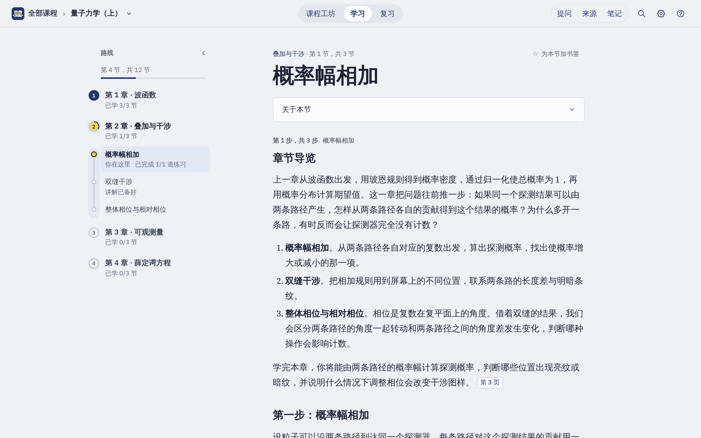
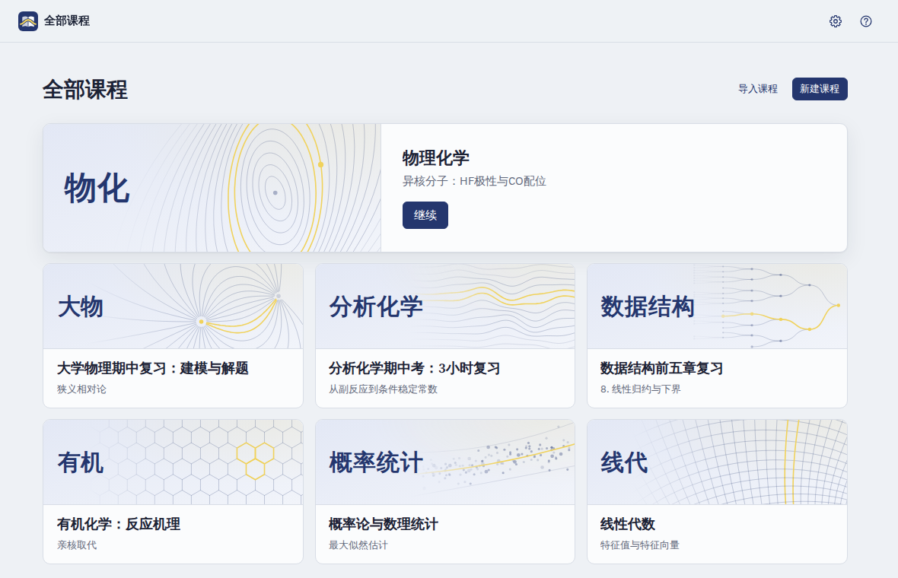
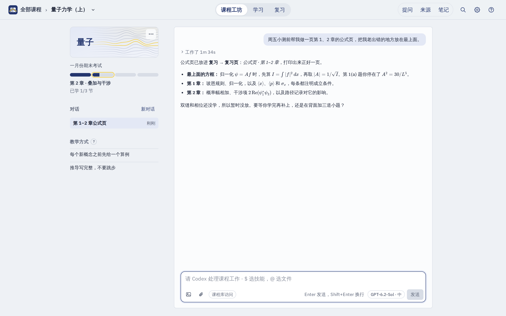
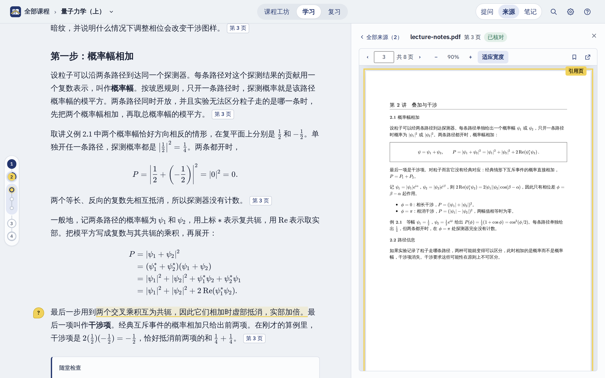
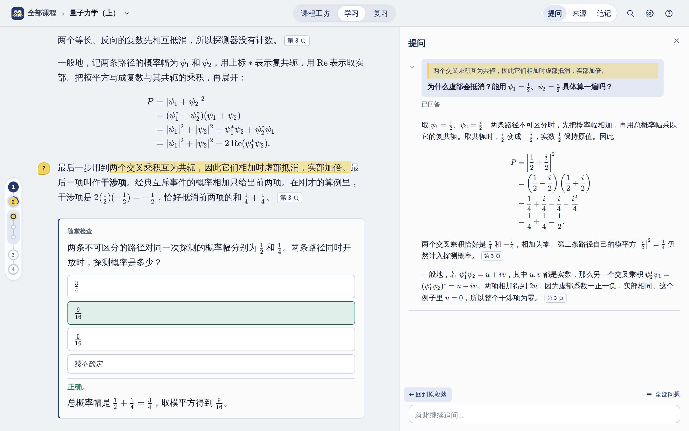
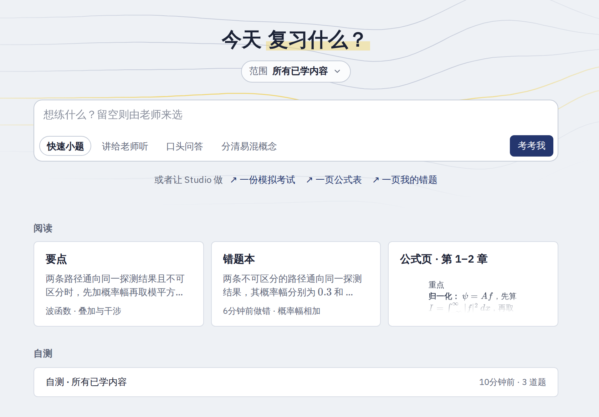

<p align="center">
  
  
</p>

<p align="center"><b>一条教学主线，贯穿你的所有资料。</b><br>本地运行的学习应用：把你的 PDF 和笔记整理成一门有引导的课程，由 Codex 授课。</p>

<p align="center"><a href="README.md">English</a> · <b>简体中文</b></p>



贯学（Throughline）把多份 PDF、幻灯片、Word 文档和文本笔记组织成一条与原文出处相连的学习路线，然后在浏览器里带你学：标明原文出处的分步讲解、每节的要点、针对任意段落提问、原文页面与讲解并排、按小题批改的练习、随时可做的复习，以及随时可以接着学的进度。Codex 本身也在旁边的课程工坊里为这门课工作。

教学判断由老师依据你的资料做出；程序只负责校验状态和引用，从不自行认定你已经掌握。所有内容都在你自己的电脑上运行，由你自己的 Codex 担任老师。

## 安装

打开终端（macOS 上是“终端”，Windows 上是 PowerShell），运行安装脚本。没有 [uv](https://docs.astral.sh/uv/) 时它会先安装 uv，uv 自带 Python：

```sh
# macOS 和 Linux
curl -LsSf https://raw.githubusercontent.com/keweijun/throughline/stable/install.sh | THROUGHLINE_LANGUAGE=zh-CN sh
```

```powershell
# Windows（PowerShell）
$env:THROUGHLINE_LANGUAGE = 'zh-CN'; irm https://raw.githubusercontent.com/keweijun/throughline/stable/install.ps1 | iex
```

脚本会安装应用（不需要 Node.js），添加 `$throughline` 技能，创建贯学文件夹，在应用菜单中添加 **Throughline** 启动器，然后在浏览器中打开贯学，并在终端中显示一份简短的欢迎指南。之后在终端中运行 `throughline` 也能打开它。

贯学由 Codex（桌面应用或 [CLI](https://learn.chatgpt.com/docs/codex/cli) 均可）授课，Codex 需要已登录或已配置 API 密钥。Codex 可以在安装贯学之前或之后设置：在它未安装或未登录时，课程库会提示该怎么做。

**更新**时，在 **设置 → 关于 → 更新** 中点一下即可：Codex 会在后台安装新版本，贯学随后自动恢复。再运行一次安装脚本也能更新。两种方式都不会影响已有课程。

### 给 Codex 的说明：更新贯学

用户或贯学的一键更新请你更新贯学时，请自己在沙箱外执行以下步骤（需要联网，并会写入工作区以外的位置），不要让用户手动输入命令。

1. 如果 `throughline --version` 已经可以运行，先执行 `throughline stop`。在 Windows 上，正在运行的贯学会锁住自身文件，导致升级失败。

   然后用当初安装它的工具卸载旧包名（0.5.1 之前的包名，会提供同一个命令）：`uv tool uninstall codex-guided-learning`、`pipx uninstall codex-guided-learning` 或 `python -m pip uninstall -y codex-guided-learning`。如果提示未安装，忽略即可。课程不受影响。
2. 用第一个可用的工具从 GitHub 安装最新发布的版本：
   - `uv tool install --reinstall-package throughline "throughline[pdf] @ git+https://github.com/keweijun/throughline@stable"`
   - `pipx install --force "throughline[pdf] @ git+https://github.com/keweijun/throughline@stable"`
   - `python -m pip install --user --upgrade "throughline[pdf] @ git+https://github.com/keweijun/throughline@stable"`

   如果这些工具都没有（或者缺少 Python 3.10 或更高版本），用 uv 的[官方安装程序](https://docs.astral.sh/uv/getting-started/installation/)安装 uv，再用第一行。

   如果之后找不到 `throughline` 命令，运行 `uv tool update-shell`（或 `pipx ensurepath`），并在下一步使用安装程序输出的完整路径。
3. 运行 `throughline setup --language zh-CN`（用户用英文交流时去掉 `--language zh-CN`）。可以重复运行：它会更新技能和启动器，不会改动已有课程，完成后会在浏览器中打开贯学。
4. 告诉用户现在安装的版本（`throughline --version`）。

`install.sh` 和 `install.ps1` 用 uv 执行同样的步骤；修改这里的步骤时请同步修改它们。

### 手动安装或更新

使用 [uv](https://docs.astral.sh/uv/)（推荐）：

```sh
throughline stop                 # 更新时执行；首次安装可跳过
uv tool install --reinstall-package throughline "throughline[pdf] @ git+https://github.com/keweijun/throughline@stable"
throughline setup --language zh-CN
```

使用 pipx 时，把第二行换成 `pipx install --force "throughline[pdf] @ git+https://github.com/keweijun/throughline@stable"`。两种方式都会获取最新发布的版本，所以安装和更新用的是同样三行命令。`stable` 始终指向最新发布的版本；每个版本也都有标签，变更记录见 [CHANGELOG.md](CHANGELOG.md)，把 `@stable` 换成 `@v0.45.0` 即可安装该版本。退回旧版本后，已被新版本更新过的课程可能无法在旧版本中打开。运行 `throughline --version` 可查看当前版本，运行 `throughline doctor` 可检查是否找到 Codex 以及它能否回复（会向一个小模型发送一条很短的消息）。

从 0.5.1 之前的版本（包名为 `codex-guided-learning`）更新时：在 `throughline stop` 之后运行 `uv tool uninstall codex-guided-learning`（或 `pipx uninstall codex-guided-learning`），再按上面的步骤继续。

卸载：先运行 `throughline stop`，再运行 `uv tool uninstall throughline`（或 `pipx uninstall throughline`），然后删除 `~/.agents/skills/throughline` 和启动器。课程会一直保留在贯学文件夹中，直到你手动删除。

## 创建第一门课程

安装完成后，贯学会在浏览器中打开课程库。**新建课程** 会问你想学什么，接下来由 **课程工坊**（在贯学里工作的 Codex）接手：

1. 把 PDF 或笔记拖到页面上（也可以写出它们所在的文件夹），再用一句话说明想学什么，例如“量子力学，学到微扰理论，为了期末考试”。
2. Codex 会先问几个简单的问题：你的目标和截止时间、对资料所需的各项先修知识掌握得如何、希望讲到多细。然后它会建议课程名，把文件复制进贯学文件夹，生成跨资料的学习路线，并告诉你哪些内容仍需核对。
3. 完成后，课程会自动打开，这段对话也随之转到它的课程工坊里。之后可以从应用菜单里的 **Throughline** 启动器打开贯学。



以后创建课程也是一样：在课程库中点击 **新建课程**，或在任意 Codex 对话中输入 `$throughline`。如果你的 Codex 版本太旧、不支持课程工坊，课程库的按钮会改为打开一段已填好请求的 Codex 对话。

## 工作方式

每门课程有三个地方，并排在顶栏里：**课程工坊 · 学习 · 复习**。

- **课程工坊** 是在这门课上工作的 Codex。可以让它加入一份习题、重建某一章、核对页面、把某一章讲得更严谨，或者给你出一份模拟考试、做一页公式表；可以附上或拖入文件、用 `@` 引用文件，并批准 Codex 的请求。它工作时你可以继续学习，需要你时顶栏会提示。对话旁边是课程封面和目标、一条按章节显示学习进度的进度条、你和课程工坊的对话，以及 **教学方式**：老师遵循的偏好。告诉课程工坊你喜欢怎么学，这门课就会记住。
- **学习** 是讲解、提问和练习的地方。它们都在后台调用 Codex，学习时不需要打开 Codex。
- **复习** 让你随时回顾学过的内容（见下文）。

课程库就是 **全部课程**：最近学的那门课排在最上面，带有 **继续** 按钮；其余每门课是一张卡片，封面由 Codex 选定。卡片的 ⋯ 菜单里有 **添加文件**（打开那门课的课程工坊并填好请求），以及分享、重命名、归档和删除。从应用菜单中的 **Throughline** 启动器打开贯学（安装时会自动添加），或运行 `throughline`；课程库会告诉你启动器在哪里、可以把它添加到桌面，Codex 无法回复时也会提示。



## 学习

- **路线**：左侧是整门课：各章、各小节，以及你学到了哪里（“第 4 节，共 12 节”）。每个小节开头是 **关于本节**：本节要回答的问题、学完能做什么、讲解步骤和资料来源。
- **分步讲解**：每章第一次讲解从章节导览开始，之后的小节先承接上一节。老师一次讲一步，常常以一道随堂检查结束，点 **继续** 往下讲。文字流式生成，完成后自动保存；可以暂停，也可以用 **再讲一次…** 把本小节重新讲成一节新讲解。
- **要点**：每个小节最后都有要点：需要掌握的结论、规则和方法，每条都注明成立条件和常见错误，并链接回讲授它的步骤和原文页。章节页会把它们汇总起来。
- **旁支提问**：在讲解或练习中选中一句话或一个公式即可提问，回答出现在侧栏，讲解停在原处。如果某个问题要到后面的小节才能讲透，它会被保存到那个小节。
- **资料原文**：把鼠标停在引用上可预览原文，点击后在内置阅读器中打开对应的页或行。尚未核对的资料会一直标注“尚未核对”。
- **练习**：每次讲解后都有练习，按小题逐一批改。**提示**、**关键步骤**、**完整解答** 和 **就此提问** 随时可用，但会如实记录，得到帮助后的正确回答不会算作独立完成。**再来一道类似的**、**稍后做** 和 **跳过** 在练习右上角的 ⋯ 里；练习不合适时，可以换一组并说明希望有什么不同。
- **帮助**：按 `?` 可以看到在整个应用、这门课和当前小节里能做什么，**指给我看** 会标出每个控件的位置，下面还有键盘快捷键。第一次遇到看不出用法的操作（比如选中一段内容）时，会有一条简短提示。

<table>
  <tr>
    <td></td>
    <td></td>
  </tr>
  <tr>
    <td align="center">引用的原文页，就在讲解旁边</td>
    <td align="center">针对某段内容的提问</td>
  </tr>
</table>

## 复习

没有到期提醒：想回顾学过的内容时，随时打开 **复习**。

- **自测**：说说想练什么，或者留空由老师来选，主要挑你答错过的和很久没练的内容。选择提问方式：**快速小题**、**讲给老师听**、**口头问答** 或 **分清易混概念**。**范围** 可以缩小到某几章或某几节。可以就答案提问，或者再要几题；做过的自测会保留，随时可以回来看。
- **阅读**：所复习内容的 **要点**、你的 **错题本**（你的作答和老师的反馈，答对之后会注明日期保留下来），以及课程工坊为你写的 **复习页**，可以直接打印。
- **让课程工坊做**：一份模拟考试、一页公式表，或一页我的错题。课程工坊会根据你的要点和错题来做；模拟考试会变成一次在复习中作答、有评分的自测，复习页会出现在“阅读”里。

学到一个建立在较早内容上的小节之前，会先提供一次简短热身；每个章节页还可以对这一章做一次自测。



界面和新的讲解默认使用英文，可以在 **设置**（顶栏中的齿轮）→ 外观 → 语言 中切换为简体中文，那里也可以选择浅色或深色，以及阅读时的文字大小。导入的资料和已有记录保留原来的语言。**设置 → 学习记录** 用日历显示你在所有课程中的学习时间。更多说明见[界面使用说明](docs/learning-ui.md)（英文）。

## 文件在哪里

- **课程**：你的贯学文件夹 `~/Throughline`（Windows 上是 `C:\Users\<你>\Throughline`）。它特意放在“文档”之外，因为“文档”常被 OneDrive 或 iCloud 同步，而同步可能损坏课程数据库。设置 `THROUGHLINE_HOME` 可改用其他文件夹；如果指向同步文件夹，请每门课程同一时间只在一台电脑上打开。其中的 `AGENTS.md` 告诉 Codex 如何在这里工作。每门课程是一个子文件夹，包含源文件（`inputs/`）、资料快照、路线、进度和学习记录，`backups/` 中还保存着每次升级课程格式之前的副本；要迁移课程，先关闭应用，再复制整个文件夹。
- **教师设置**：点击顶栏中的齿轮打开 **设置**，在教师一项中选择你的 Codex 账号提供的模型：教师模型、用于准备后续小节和整理笔记的小模型、各自的推理强度和快速模式。课程工坊自己的模型和访问权限（课程库访问或完全访问）在它的输入框里选择，和在 Codex 中一样。设置按用户保存在 `~/.config/throughline/settings.json`（Windows 上是 `%APPDATA%\throughline\settings.json`），不会写进任何课程。

文字提取并不能保证公式、图片或覆盖范围正确，所以课程库和阅读器会标出仍需核对的内容。参见[创建与核对课程](docs/course-import.md)（英文）。

## 指令背后的命令

```sh
throughline setup                 # 安装或更新 Codex 技能
throughline open [课程名] [--no-browser] [--port 8765]
throughline stop
throughline courses               # 以 JSON 列出课程库
echo '{"op":"course.status"}' | throughline --course quantum
```

最后一种写法是技能使用的操作入口：从标准输入或 `--request 文件.json` 读取一条 JSON 请求，返回 `{ok, result}` 或 `{ok:false, error}`。`--workspace <目录>` 可操作课程库之外的课程，`throughline-web --workspace <目录>` 则在前台为它启动界面。技能及其操作说明位于 [throughline/skill/](throughline/skill/SKILL.md)。

## 开发

```sh
python -m venv .venv
.venv/bin/python -m pip install -e ".[pdf,dev]"    # Windows: .venv\Scripts\python.exe
.venv/bin/python -m unittest discover -s tests
.venv/bin/throughline setup                     # 把当前检出的技能复制给 Codex；修改技能后需重新运行

cd web && npm install
GL_HOST=http://127.0.0.1:8765 npm run dev          # 连接运行中的服务，热更新界面
npm run check && npm run build                     # 类型检查，然后生成 throughline/web_dist（需提交）
npx playwright test                                # 用临时示例课程运行浏览器测试
```

较大的改动前请先阅读[架构](docs/architecture.md)、[术语表](GLOSSARY.md)和[设计决策](docs/adr/)（均为英文）；面向智能体的说明在 [AGENTS.md](AGENTS.md)。任务通过 GitHub Issues 管理。CI 会在每个拉取请求上运行以上全部检查；合并到 `main` 的版本号更新会被打上标签，连同 [CHANGELOG.md](CHANGELOG.md) 中的条目一起发布，成为用户安装的版本（[ADR 0021](docs/adr/0021-releases-are-tagged-from-main.md)）。

贯学采用 [MIT](LICENSE) 许可证；随附的第三方依赖保留各自的许可证，见[第三方许可声明](THIRD_PARTY_LICENSES.md)。Python 包名为 `throughline`（0.5.1 之前为 `codex-guided-learning`），命令名为 `throughline`。
