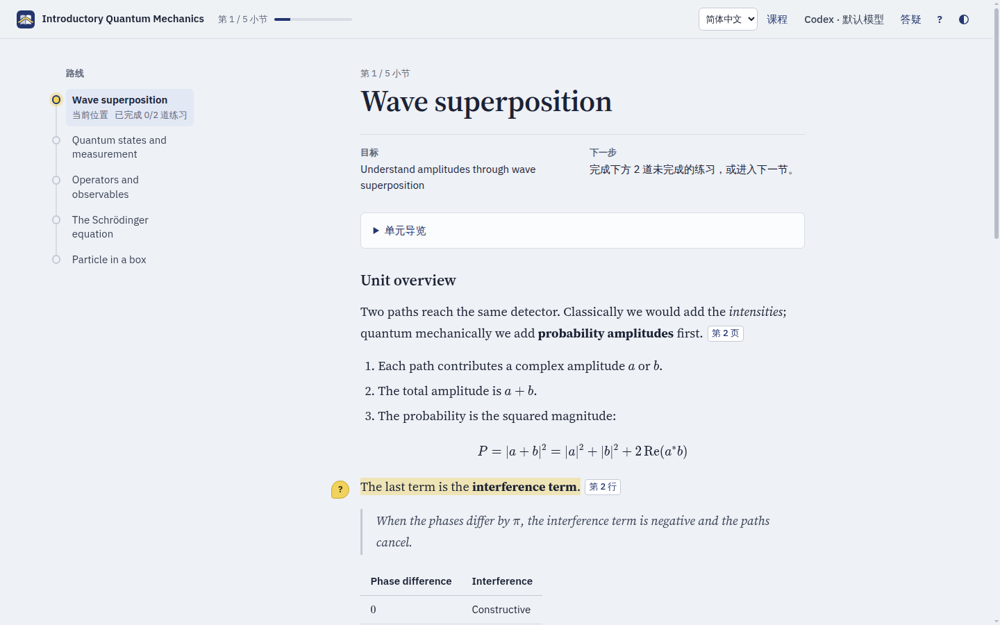
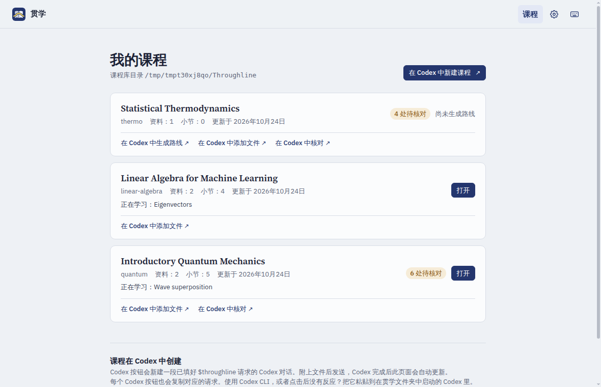
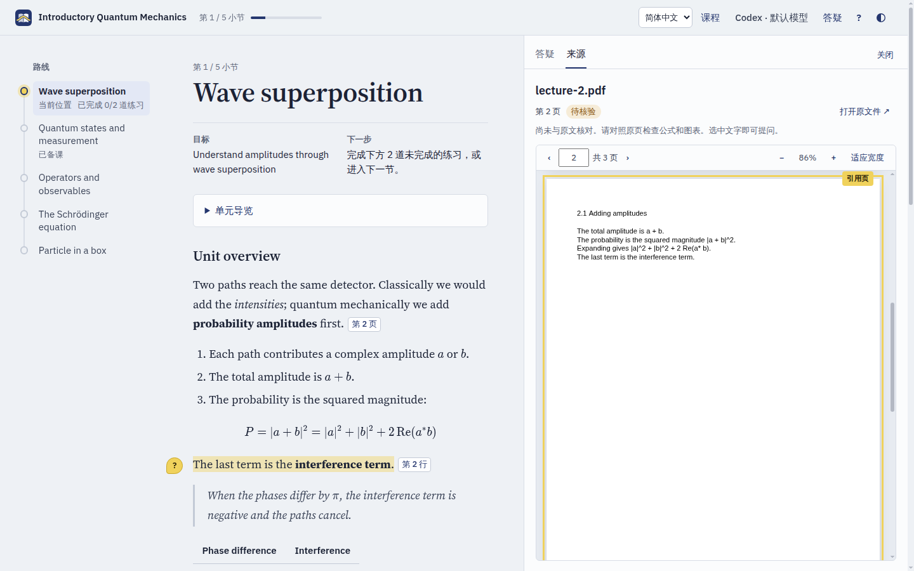
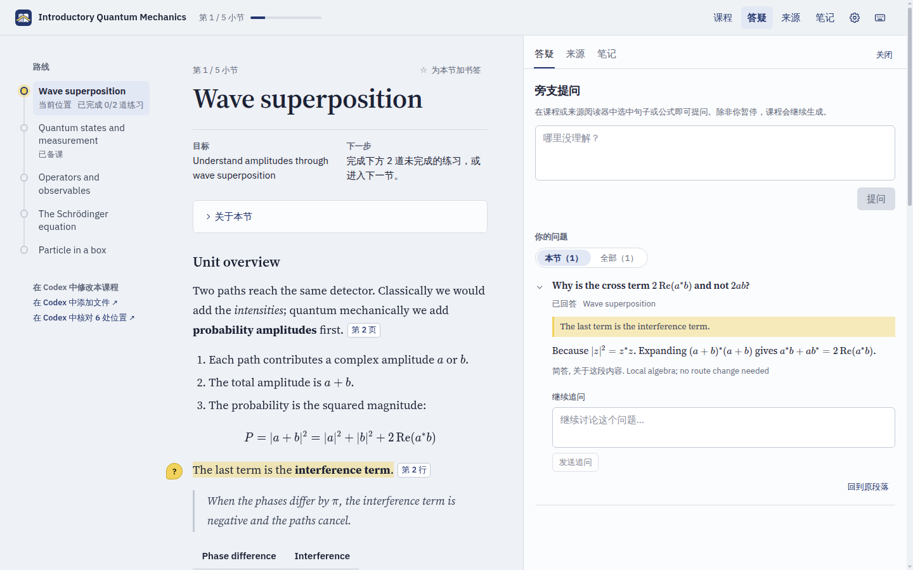

<p align="center">
  
  
</p>

<p align="center"><b>一条教学主线，贯穿你的所有资料。</b><br>本地运行的学习应用：把你的 PDF 和笔记整理成一门有引导的课程，由 Codex 授课。</p>

<p align="center"><a href="README.md">English</a> · <b>简体中文</b></p>



贯学（Throughline）把多份 PDF 和 Markdown 资料组织成一条与原文出处相连的学习路线，然后在浏览器里带你学：章节导览、流式讲解、针对任意段落提问、原文页面与讲解并排、练习，以及随时可以接着学的进度。

教学判断由老师依据你的资料做出；程序只负责校验状态和引用，从不自行认定你已经掌握。所有内容都在你自己的电脑上运行，由你自己的 Codex 担任老师。

## 安装

你需要已登录的 Codex（桌面应用或 [CLI](https://learn.chatgpt.com/docs/codex/cli) 均可）以及 Python 3.10 或更高版本。然后把这句话粘贴到 Codex：

```text
安装 https://github.com/keweijun/throughline
```

Codex 会按下面的步骤安装应用（不需要 Node.js），添加 `$throughline` 技能，创建贯学文件夹，在应用菜单中添加 **Throughline** 启动器，并显示一份简短的欢迎指南。**更新**时粘贴 `更新 https://github.com/keweijun/throughline` 即可，已有课程不受影响。

### 给 Codex 的说明：安装或更新贯学

用户请你安装或更新贯学时，请自己在沙箱外执行以下步骤（需要联网，并会写入工作区以外的位置），不要让用户手动输入命令。

1. 如果 `guided-learning --version` 已经可以运行，先执行 `guided-learning stop`。在 Windows 上，正在运行的贯学会锁住自身文件，导致升级失败。
2. 用第一个可用的工具从 GitHub 安装最新版：
   - `uv tool install --reinstall "codex-guided-learning[pdf] @ git+https://github.com/keweijun/throughline"`
   - `pipx install --force "codex-guided-learning[pdf] @ git+https://github.com/keweijun/throughline"`
   - `python -m pip install --user --upgrade "codex-guided-learning[pdf] @ git+https://github.com/keweijun/throughline"`

   如果之后找不到 `guided-learning` 命令，运行 `uv tool update-shell`（或 `pipx ensurepath`），并在下一步使用安装程序输出的完整路径。
3. 运行 `guided-learning setup --language zh-CN`（用户用英文交流时去掉 `--language zh-CN`）。可以重复运行：它会更新技能和启动器，不会改动已有课程。
4. 把 setup 输出的欢迎指南原样展示给用户。如果是更新，只需告诉用户当前版本（`guided-learning --version`）。

### 手动安装或更新

使用 [uv](https://docs.astral.sh/uv/)（推荐）：

```sh
guided-learning stop                 # 更新时执行；首次安装可跳过
uv tool install --reinstall "codex-guided-learning[pdf] @ git+https://github.com/keweijun/throughline"
guided-learning setup --language zh-CN
```

使用 pipx 时，把第二行换成 `pipx install --force "codex-guided-learning[pdf] @ git+https://github.com/keweijun/throughline"`。两种方式都会获取最新版，所以安装和更新用的是同样三行命令。运行 `guided-learning --version` 可查看当前版本。

卸载：先运行 `guided-learning stop`，再运行 `uv tool uninstall codex-guided-learning`（或 `pipx uninstall codex-guided-learning`），然后删除 `~/.agents/skills/throughline` 和启动器。课程会一直保留在贯学文件夹中，直到你手动删除。

## 创建第一门课程

安装完成后，Codex 会显示一份简短的欢迎指南。之后在任意 Codex 对话中以 **`$throughline`** 开头，就能处理你的课程。

1. 输入 `$throughline 用这些文件建一门课`，附上你的 PDF 或笔记（也可以写出它们所在的文件夹），再用一句话说明想学什么，例如“量子力学，学到微扰理论，为了期末考试”。
2. Codex 会先问几个简单的问题：你的目标和截止时间、对资料所需的各项先修知识掌握得如何、希望讲到多细。然后它会建议课程名，把文件复制进贯学文件夹，生成跨资料的学习路线，并告诉你哪些内容仍需核对。
3. 完成后，课程会在浏览器的贯学中打开。之后可以从应用菜单里的 **Throughline** 启动器直接打开。

以后创建课程也是一样：在任意 Codex 对话中输入 `$throughline`，或在贯学课程库中点击 **在 Codex 中新建课程**。

## 工作方式

在贯学里学习，在 Codex 里创建课程，两者之间一键切换。

- **在贯学里学习**：从应用菜单中的 **Throughline** 启动器打开（安装时会自动添加）。讲解、提问和练习都在后台调用 Codex，学习时不需要打开 Codex。
- **在 Codex 里创建课程**：在任意 Codex 对话中以 `$throughline` 开头。在课程库中点击 **在 Codex 中新建课程**、**在 Codex 中添加文件** 或 **在 Codex 中核对**，会新建一段已填好 `$throughline` 请求的 Codex 对话：附上文件后发送即可。Codex 读完资料、生成路线后会在贯学中打开这门课程；已打开的贯学页面会自动更新。
- **想做什么直接说**：`$throughline 把这份习题加入 quantum`、`$throughline 把量子课讲得更严谨些`、`$throughline 打开 quantum`。Codex 第一次启动贯学时会请求权限，因为应用会在后台持续运行。



## 学习

- **路线与目标**：左侧是课程路线，每个小节都标明目标和下一步该做什么。
- **讲解**：每章第一次讲解从章节导览开始，之后的小节先用一两句话承接上一节，然后进入正文。文字流式生成，完成后自动保存；可以暂停，也可以请老师再讲一遍。
- **旁支提问**：选中一句话或一个公式即可提问，讲解默认继续进行，除非你选择暂停。如果某个问题要到后面的小节才能讲透，它会被保存到那个小节。
- **资料原文**：把鼠标停在引用上可预览原文，点击后在内置阅读器中打开对应的页或行。尚未核对的资料会一直标注"尚未核对"。
- **练习**：每次讲解后都有练习。提示和答案随时可看，但会如实记录，得到帮助后的正确回答不会算作独立完成。
- **复习**：做对过练习的小节会在 1、3、7、21 天后、之后每 60 天带着一道新题回来，让你凭记忆作答，每天最多五节；顶栏的 **复习** 显示今天待复习的数量。章节回顾最后也会给出几道贯穿全章的此类问题。

<table>
  <tr>
    <td></td>
    <td></td>
  </tr>
  <tr>
    <td align="center">引用的原文页，就在讲解旁边</td>
    <td align="center">针对某段内容的旁支提问</td>
  </tr>
</table>

界面和新的讲解默认使用英文，可以在 **设置**（顶栏中的齿轮）的语言一项中切换为简体中文。导入的资料和已有记录保留原来的语言，所以上图中的英文课程内容不会被翻译。更多说明见[界面使用说明](docs/learning-ui.md)（英文）。

## 文件在哪里

- **课程**：你的贯学文件夹 `~/Throughline`（Windows 上是 `C:\Users\<你>\Throughline`）。它特意放在“文档”之外，因为“文档”常被 OneDrive 或 iCloud 同步，而同步可能损坏课程数据库。设置 `GUIDED_LEARNING_HOME` 可改用其他文件夹；如果指向同步文件夹，请每门课程同一时间只在一台电脑上打开。其中的 `AGENTS.md` 告诉 Codex 如何在这里工作。每门课程是一个子文件夹，包含源文件（`inputs/`）、资料快照、路线、进度和学习记录；要迁移课程，先关闭应用，再复制整个文件夹。
- **教师设置**：点击顶栏中的齿轮打开 **设置**，在教师一项中选择你的 Codex 账号提供的模型：教师模型、用于准备后续小节和整理笔记的小模型、各自的推理强度，以及快速模式。设置按用户保存在 `~/.config/guided-learning/settings.json`（Windows 上是 `%APPDATA%\guided-learning\settings.json`），不会写进任何课程。

文字提取并不能保证公式、图片或覆盖范围正确，所以课程库和阅读器会标出仍需核对的内容。参见[创建与核对课程](docs/course-import.md)（英文）。

## 指令背后的命令

```sh
guided-learning setup                 # 安装或更新 Codex 技能
guided-learning open [课程名] [--no-browser] [--port 8765]
guided-learning stop
guided-learning courses               # 以 JSON 列出课程库
echo '{"op":"course.status"}' | guided-learning --course quantum
```

最后一种写法是技能使用的操作入口：从标准输入或 `--request 文件.json` 读取一条 JSON 请求，返回 `{ok, result}` 或 `{ok:false, error}`。`--workspace <目录>` 可操作课程库之外的课程，`guided-learning-web --workspace <目录>` 则在前台为它启动界面。技能及其操作说明位于 [guided_learning/skill/](guided_learning/skill/SKILL.md)。

## 开发

```sh
python -m venv .venv
.venv/bin/python -m pip install -e ".[pdf]"        # Windows: .venv\Scripts\python.exe
.venv/bin/python -m unittest discover -s tests
.venv/bin/guided-learning setup                     # 把当前检出的技能复制给 Codex；修改技能后需重新运行

cd web && npm install
GL_HOST=http://127.0.0.1:8765 npm run dev          # 连接运行中的服务，热更新界面
npm run check && npm run build                     # 类型检查，然后生成 guided_learning/web_dist（需提交）
npx playwright test                                # 用临时示例课程运行浏览器测试
```

较大的改动前请先阅读[架构](docs/architecture.md)、[术语表](GLOSSARY.md)和[设计决策](docs/adr/)（均为英文）；面向智能体的说明在 [AGENTS.md](AGENTS.md)。任务通过 GitHub Issues 管理。

贯学采用 [MIT](LICENSE) 许可证；随附的第三方依赖保留各自的许可证，见[第三方许可声明](THIRD_PARTY_LICENSES.md)。Python 包和命令名为 `guided-learning`（包名 `codex-guided-learning`）。
